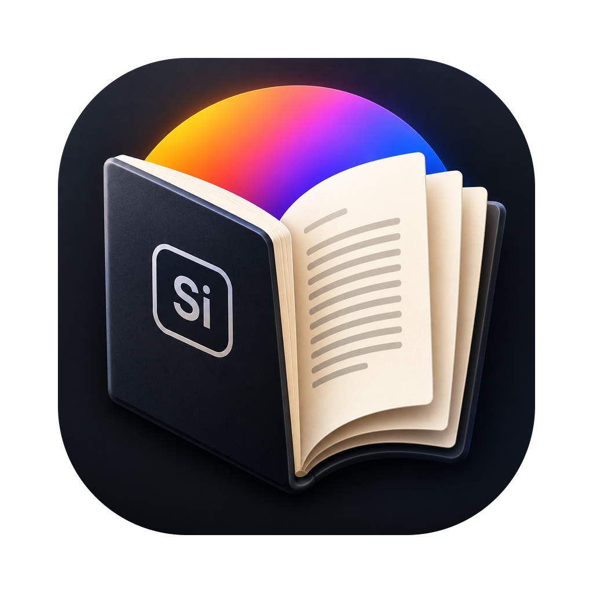
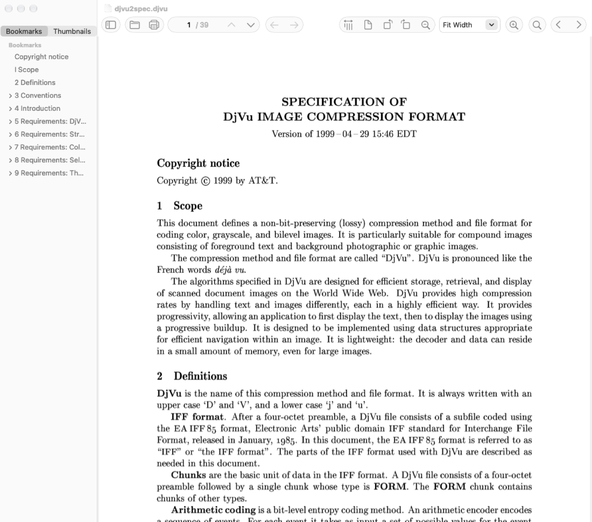
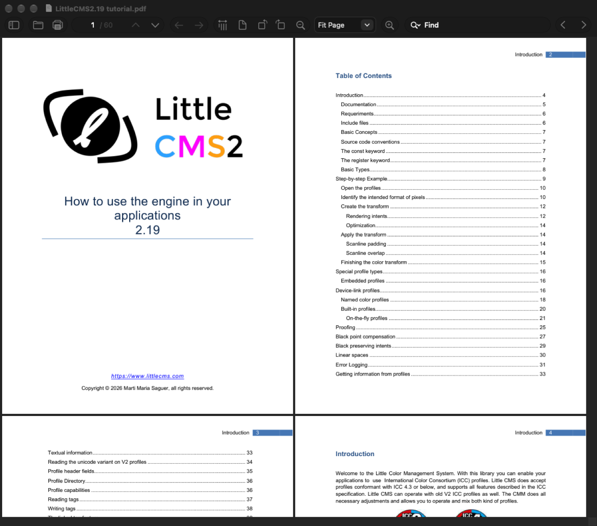
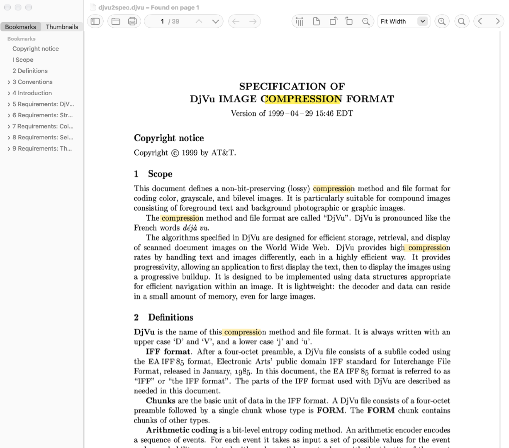

#  Silicon Reader

🇬🇧 English | [🇷🇺 Русский](README.ru.md)

A fast, keyboard-driven PDF and DjVu reader for macOS on Apple Silicon, in the spirit of
[SumatraPDF](https://github.com/sumatrapdfreader/sumatrapdf): native Swift + AppKit on top of
the same engines Sumatra uses.


[](https://github.com/Arroheim/silicon_reader/releases/latest)




## ✨ Features

- 📖 **PDF and DjVu** — MuPDF 1.28 for PDF, djvudec (Sumatra's own decoder) for DjVu
- 🧭 **SumatraPDF's layouts** — single page, facing, book view; continuous or paged
- 🔍 **Zoom like Sumatra** — fit page / width / height / content, actual size, 8.33 %–6400 %
  in Sumatra's steps, pinch and ⌘-scroll on the trackpad
- ⌨️ **Sumatra's keyboard map** adapted to macOS — `j` `k` `n` `p` `z` `c` `[` `]`, ⌘K palette,
  `?` for the full list
- 🗂️ **Tabs, bookmarks and favorites** — native tabs, table of contents and favorites in the sidebar
- 🖼️ **Page thumbnails** in the sidebar that follow the page you read
- 📂 **Open Recent** and **drag and drop** — drop files on a window to open them as tabs
- ⚙️ **Settings** — default layout and zoom, what to remember, session restore, auto reload
- 🏠 **Home page** with "Frequently Read" thumbnails
- 🔎 **Find** with highlights for every match, match case, ⌘G / ⇧⌘G or the arrows next to the search field
- ✂️ **Text selection and copy**, double/triple click, zoom to selection, clickable links
- 💾 **Remembers everything** — page, zoom and layout per document, restores the session
- 🔄 **Reloads automatically** when a file changes on disk (handy with LaTeX)
- 🖨️ **Print**, document properties, presentation and full screen modes, inverted colors
- ⚡ **Background tiled rendering** — the page you look at is sharp first, the rest follows
- 🧪 **Tested**: unit tests, end-to-end tests that drive the real app, and a batch checker
  run over a 1 300-book library

<p align="center">
  
  
</p>

## 📥 Download

Get the DMG from the [latest release](https://github.com/Arroheim/silicon_reader/releases/latest),
open it and drag **SiliconReader** onto **Applications**.

The app is not notarized by Apple yet, so macOS blocks the first launch. Either open
**System Settings → Privacy & Security** and click **Open Anyway**, or run:

```bash
xattr -dr com.apple.quarantine /Applications/SiliconReader.app
```

Requires macOS 14 or later on Apple Silicon. Every release is tested on macOS 14 and
on the latest macOS.

## 🚀 Quick Start (from source)

Only the Xcode **Command Line Tools** are needed (`xcode-select --install`), not full Xcode.

```bash
git clone --recurse-submodules --shallow-submodules https://github.com/Arroheim/silicon_reader.git
cd silicon_reader
make run FILE=path/to/book.djvu
```

The first build compiles MuPDF (about a minute); later builds take seconds.

## ⌨️ Keyboard

The most used shortcuts; press `?` in the app for all of them.

| Keys | Action |
|---|---|
| `j` `k` / `↓` `↑` | Scroll |
| `Space` / `⇧Space` | Screen down / up |
| `n` `p` | Next / previous page |
| `Home` `End`, `⌘↑` `⌘↓` | First / last page |
| `g`, `⌥⌘G` | Go to page |
| `⌘[` `⌘]`, `⌫` | Back / forward |
| `⌘9` `⌘2` `⌘3` `⌘0` | Fit page / width / content, actual size |
| `⌘+` `⌘-`, `z` | Zoom in / out, cycle fit modes |
| `⌘6` `⌘7` `⌘8`, `c` | Single / facing / book view, continuous on/off |
| `[` `]` | Rotate |
| `⌘F`, `⌘G` `⇧⌘G` | Find, next / previous match |
| `⌘K` (or `>` `@` `#` `$` `%`) | Command palette (commands, tabs, recent, favorites, bookmarks) |
| `⌘D` | Add to favorites |
| `⌃⌘S` | Show / hide sidebar |
| `⌥⌘2` / `⌥⌘3` | Sidebar: page thumbnails / bookmarks |
| `⌘,` | Settings |
| `⇧⌘F`, `f` | Presentation, full screen |
| `⇧I` | Invert colors |
| `⇧⌘→` `⇧⌘←` | Next / previous file in the folder |

## 🏗️ Architecture

```
Sources/
├── CMuPDF/          C facade over MuPDF (fz_try/fz_catch can't cross into Swift)
├── ReaderCore/      no AppKit, fully unit-tested
│   ├── Layout/      SumatraPDF's page layout and zoom model, page geometry
│   ├── Text/        selection, search across pages, text cache
│   ├── Commands/    the keyboard/menu command table, palette matching
│   ├── Library/     history, favorites, per-file state, session, file watcher
│   ├── Control/     debug control channel protocol (used by e2e tests)
│   └── *Engine.swift  MuPDF and DjVu document engines
├── SiliconReader/   AppKit app: canvas, window, toolbar, sidebar, home page, palette
└── ReaderCheck/     batch checker for document libraries
Vendor/
├── mupdf/           git submodule, pinned to a release tag
└── djvudec/         vendored single-file DjVu decoder (+ local patches)
Tests/
├── ReaderCoreTests/ unit tests
└── E2ETests/        drive the built app over its control socket
```

## 🧪 Development

| Command | What it does |
|---|---|
| `make deps` | Fetch submodules and build MuPDF as static libraries (once) |
| `make build` | `swift build` (`CONFIG=release` for an optimized build) |
| `make test` | Unit tests |
| `make e2e` | Build the app and run the end-to-end tests against it |
| `make lint` / `make format` | `swift format` check / rewrite |
| `make app` | Release build wrapped into `build/SiliconReader.app` |
| `make smoke` | Open sample documents in several view modes and save window snapshots |
| `make test-swift60` | Unit and e2e tests built with Swift 6.0.3, the toolchain of the macOS 14 CI job (prints how to install it) |
| `make e2e-prebuilt` / `make smoke-prebuilt` | The same against an existing `build/SiliconReader.app` (CI runs them on macOS 14) |
| `make check-library DIR=…` | Open every PDF/DjVu under a folder, render sample pages (or all with `ALL_PAGES=1`), report failures |
| `make dmg` | Pack the app into `build/SiliconReader-<version>.dmg` |
| `make release VERSION=x.y.z` | Check, test and tag a release |
| `make run FILE=…` | Build and open a document |

**End-to-end tests** start the real app with `-control <socket>` and talk JSON over a Unix
socket: they press keys through the real menu bar and key handling, then assert on reported
state (page, zoom, selection, search match, tabs) rather than on pixels. The protocol lives in
`Sources/ReaderCore/Control/ControlProtocol.swift`.

**Debug flags** for snapshots and tests: `-snapshot out.png`, `-actions a,b`, `-find text`,
`-palette text`, `-printToPDF out.pdf`, `-library path.json` (keeps tests away from your own
history), `-persist YES`, `-snapshotAfter N`.

> With the Command Line Tools toolchain, plain `swift test` intermittently fails with
> `plugin for module 'TestingMacros' not found`. The Makefile loads the plugin explicitly —
> use `make test`.

## 🚢 Releasing

1. Rename `## [Unreleased]` in [CHANGELOG.md](CHANGELOG.md) to `## [x.y.z] - YYYY-MM-DD` and commit.
2. `make release VERSION=x.y.z` — checks the tree and changelog, runs lint, unit and e2e tests (also with Swift 6.0.3, see `make test-swift60`), tags `vx.y.z`.
3. `git push origin vx.y.z` — the [release workflow](.github/workflows/release.yml) tests again,
   builds the DMG and publishes a GitHub release with it and the changelog section as notes.

## 📦 Dependencies

| Component | Version | License | How |
|---|---|---|---|
| [MuPDF](https://mupdf.com) | 1.28.5 | AGPL-3.0 | git submodule, static library |
| [djvudec](https://github.com/kjk/djvudec) | `cfd3251` + [local patch](Vendor/djvudec/PATCHES.md) | MIT | vendored `djvu.c` / `djvu.h` |
| Swift Testing | toolchain | Apache-2.0 | unit and e2e tests |

Toolchain: Swift 6 and the newest macOS SDK you have; the app targets macOS 14
(`MIN_MACOS` in the Makefile, checked by `scripts/check-binary.sh`). Apple Silicon.

## 🗺️ Roadmap

See [TODO.md](TODO.md): the 1.0 release checklist, the remaining gaps to SumatraPDF
(annotations, forms, SyncTeX, settings and themes…) and phase 2 — EPUB, MOBI, FB2, XPS,
CBZ/CBR.

## 🤝 Contributing

1. Fork the repository
2. Create a feature branch (`git checkout -b feature/amazing-feature`)
3. Run `make lint test e2e`
4. Commit your changes using [Conventional Commits](https://www.conventionalcommits.org/)
5. Push the branch and open a Pull Request

## 🙏 Acknowledgements

[SumatraPDF](https://github.com/sumatrapdfreader/sumatrapdf) by Krzysztof Kowalczyk and
contributors — its behavior, layouts and keyboard map are the specification this app follows.

## 📝 License

[AGPL-3.0-or-later](LICENSE), as required by MuPDF. djvudec is MIT-licensed. Test fixtures
come from DjVuLibre and SumatraPDF under the GPL (see
[Tests/ReaderCoreTests/Fixtures/README.md](Tests/ReaderCoreTests/Fixtures/README.md)).
